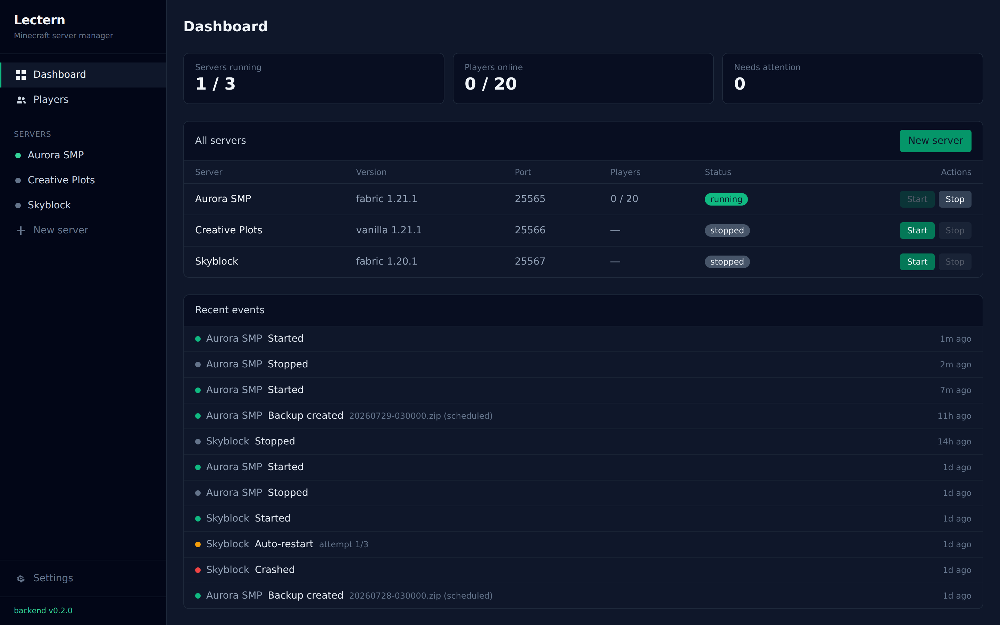
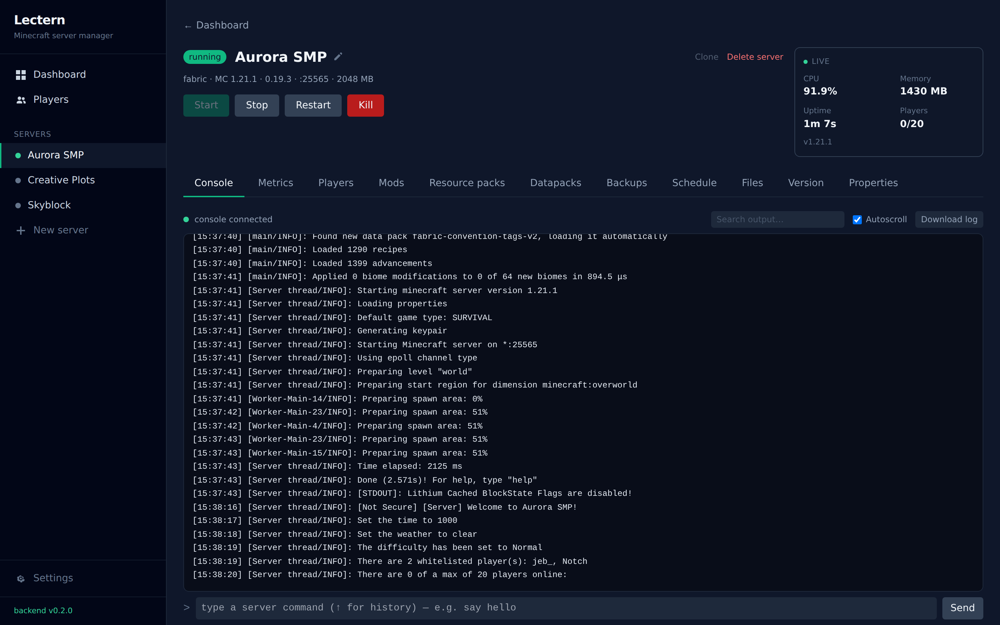
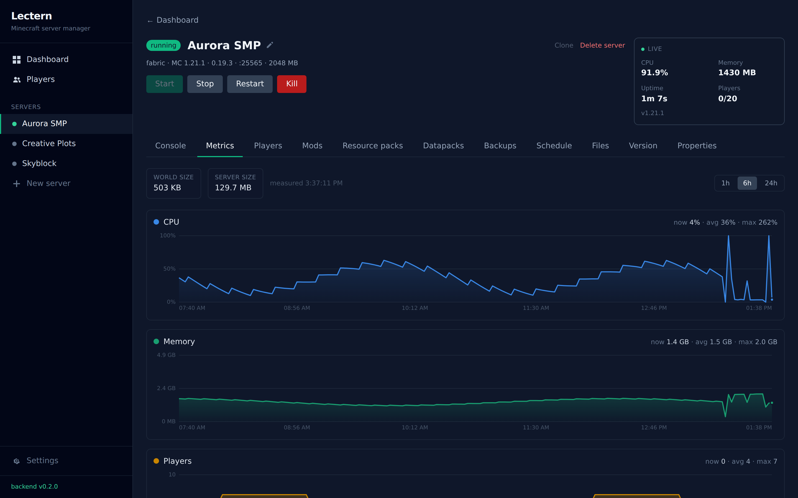
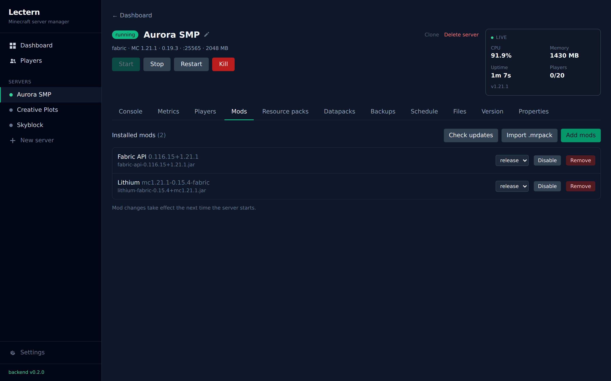
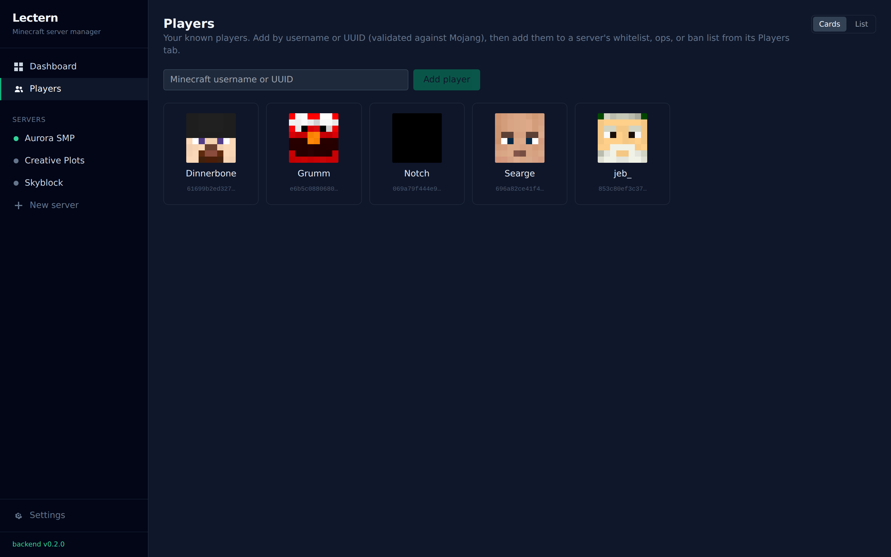

# Lectern

[](https://github.com/kernelcoffee/Lectern/actions/workflows/ci.yml)
[](https://github.com/kernelcoffee/Lectern/tags)
[](https://github.com/kernelcoffee/Lectern/pkgs/container/lectern)


[](https://claude.com/claude-code)
[](LICENSE)

Lectern is a simple-to-install, self-hosted **web app for creating and managing modded Minecraft servers**.
Your servers run in the background on your own hardware; everything — process control, live console, mods, backups, schedules, even a Velocity proxy in front of your instances — is managed from the browser. No accounts, no heavy auth: built for a trusted LAN.

Choose a server and Lectern takes care of everything else — it downloads what that version
needs (including the right Java) and runs it for you.



| Live console | Resource metrics |
|---|---|
|  |  |

| Modrinth mods | Player registry |
|---|---|
|  |  |

## Features

- **Servers** — Vanilla, **Fabric**, **Quilt**, **NeoForge** and **Forge**, with a live
  console, status that updates instantly everywhere, stats, an online player roster (live
  through Mojang's Server Management Protocol on 1.21.9+, console parsing otherwise), and easy
  settings editing (on 1.21.9+ the MOTD, difficulty, player limit, view distance, whitelist
  switches and default gamemode apply without a restart).
- **Proxy** — put your servers behind **one address** with a **Velocity** proxy: players
  connect once and hop between servers. Pick the servers to put behind it — Lectern does
  all the wiring for you.
- **Mods & packs** — search and install mods from **Modrinth** (dependencies come along
  automatically, updates are one click), add **Vanilla Tweaks** packs, or import a whole
  modpack (`.mrpack`).
- **Version changes** — move a server to a new Minecraft version. Compatible mods get
  updated, the rest are safely disabled — and you see what will happen before you commit.
- **Worlds** — start a new server from an existing world: upload a zip or paste a link.
- **Backups** — create, restore, download, or upload one back (e.g. after editing it offline);
  old ones are cleaned up automatically.
- **Scheduling** — nightly restarts, daily backups, timed commands — set up in plain
  words, no cron knowledge needed.
- **Event timeline** — what happened while you were away: crashes, restarts and backup
  results, so a 3 a.m. incident is still visible in the morning.
- **File manager** — browse, edit, upload and unzip server files right in the browser.
- **Settings** — app-level limits and defaults, editable from the UI.

Paper and Bedrock support may come later.

> **Why no CurseForge?** The official CurseForge API is key-gated per application. Desktop
> launchers can embed an approved key in their compiled binaries, but Lectern is open source with
> a public image — an embedded key would be public, which the key terms forbid — so every
> deployment would need to apply for its own key just to search mods. Modrinth needs no key and
> covers the actively-maintained modding ecosystem; for CurseForge-only mods, download the jar in
> a browser and drop it onto the server with the file manager (mods land in `mods/`).

## Quick start (production, one command)

Requires Docker (or Podman) with the Compose plugin.

```bash
docker compose up -d
```

Then open **http://localhost:8000** (or `http://<host-ip>:8000` on your LAN). Minecraft clients
connect on **25565**.

This pulls the pre-built image `ghcr.io/kernelcoffee/lectern` — a single container that serves the
API and the built web UI on one port. All state (database, downloaded JREs, caches, backups,
server files) lives in the `lectern_data` volume.

Images are published on two channels, selected with `LECTERN_TAG`:

| Tag | Tracks |
|---|---|
| `latest` / `stable` | The newest tagged release (default). |
| `master` | Every push to the `main` branch that passes CI — bleeding edge. |
| `1.2.3` / `1.2` | An exact release / its patch line. |

```bash
LECTERN_TAG=1.2.3 docker compose up -d          # pin a version
LECTERN_TAG=master docker compose up -d         # ride the main branch
docker compose pull && docker compose up -d     # upgrade in place
```

**Stopping and upgrading with servers running.** When the container stops (an upgrade, `docker
compose down`, a host reboot) Lectern stops every running Minecraft server the way the Stop
button does: each gets its own stop command and graceful-stop timeout, all at the same time, so
worlds are saved. A server that ignores the stop is terminated, then killed. Lectern's log
(`docker logs lectern`) has one `shutdown:` line per server saying how it ended. Servers that
were running are not started again on the next boot; only auto-start servers are.

The shipped `docker-compose.yml` sets `stop_grace_period: 2m`; Docker's default of 10 s would
kill slower servers mid-save. Two minutes covers a per-server graceful-stop timeout up to about
75 s: 15 s for requests still open (uvicorn cancels them after that, see the image's
`--timeout-graceful-shutdown 15`), the timeout itself, 10 s for the terminate step and a margin.
If you raise a server's timeout above that, raise the grace period by the same amount. If you
run your own compose file or `docker run`, add the value yourself:

```bash
docker run --stop-timeout 120 ...               # same as stop_grace_period: 2m
```

A hard kill of Lectern (`docker kill`, power loss, out-of-memory kill) still loses what the last
autosave did not write.

> **Multiple servers / custom ports:** the compose file publishes a single `25565`. To run
> several servers at once, or use custom per-server ports, publish a range instead — e.g.
> `"25565-25575:25565-25575"` in `docker-compose.yml`.
>
> **Build from source instead of pulling:** run `docker build -t lectern .` against the
> `Dockerfile`, or use the hot-reload stack in `docker-compose.dev.yml` (see Development below).

## Configuration

Everything is optional. Deployment settings are environment variables:

| Variable | Default | Purpose |
|---|---|---|
| `LECTERN_DATA` | `/data` (image) | Directory for the DB, JREs, caches, backups, and server files. |
| `LECTERN_HOST` | `0.0.0.0` | API/web bind address. |
| `LECTERN_PORT` | `8000` | API/web port. |
| `LECTERN_ALLOWED_HOSTS` | *(empty)* | Extra names or IP addresses Lectern may be reached by, comma-separated and exact (e.g. `mc.example.org,192.0.2.5`). `*` switches the Host and Origin checks off. See below. |

### App settings

These are editable at runtime from the in-app **Settings** page and persisted in the database.
The environment variables only set their defaults (a value saved on the Settings page wins).

| Variable | Default | Settings label |
|---|---|---|
| `LECTERN_DEFAULT_MEMORY_MB` | `2048` | Default server memory |
| `LECTERN_DEFAULT_PROXY_MEMORY_MB` | `512` | Default proxy memory |
| `LECTERN_MAX_FILE_UPLOAD_MB` | `2048` | File manager upload limit |
| `LECTERN_MAX_WORLD_UPLOAD_MB` | `20480` | World import upload limit |
| `LECTERN_MAX_BACKUP_UPLOAD_MB` | `16384` | Backup upload limit |
| `LECTERN_RESTORE_DISK_RESERVE_MB` | `1024` | Restore disk reserve |

The restore disk reserve is the free space a restore must leave on the disk once the backup is
unpacked; `0` keeps only the check that the backup fits.

Lectern is built for a **trusted LAN** — there is no user auth. Don't expose it directly to the
internet; put it behind a VPN or a reverse proxy with access control if you need remote access.

### Host and Origin check

Your browser sits on the LAN, so a web page from outside it could use it to talk to Lectern
(send console commands, change servers, or reach the API through DNS rebinding). Lectern
therefore refuses, before any route runs, every request and WebSocket handshake whose `Host` or
`Origin` header is not the LAN. Two rules, both needing no configuration for a normal install:

- **Host** (the address the request was sent to): any IP address, `localhost`, a single-word
  name (`pi`, `backend`), or a name ending in `.local`, `.lan`, `.home.arpa` or `.internal`.
  Anything else must be listed in `LECTERN_ALLOWED_HOSTS`.
- **Origin** (the page making the request; checked only when the request carries one, so
  `curl` and scripts pass): the same host name as `Host`, a loopback, private (10/8, 172.16/12,
  192.168/16, fc00::/7) or link-local IP address, a name the Host rule accepts without an
  entry, or a listed name. A public IP address is not accepted as Origin unless listed, and
  `Origin: null` is always refused. Ports are ignored.

A refused request gets `403` with a message naming `LECTERN_ALLOWED_HOSTS`; a refused WebSocket
handshake is closed with code `1008` before it is accepted.

**Behind a reverse proxy**, list the public name (`LECTERN_ALLOWED_HOSTS=mc.example.org`) even
when the proxy rewrites `Host` to something internal: the browser's `Origin` still carries the
public name, and it is refused otherwise. Entries may be names or IP addresses.

`LECTERN_ALLOWED_HOSTS=*` switches both checks off and logs a warning at startup. Only use it
if something else already keeps foreign pages out.

## Development

### With Docker/Podman (hot-reload)

```bash
docker compose -f docker-compose.dev.yml up
```

- Backend: http://localhost:8000 (health at `/api/health`)
- Frontend (Vite, proxies `/api`): http://localhost:5173

### Locally, without containers

Backend:

```bash
cd backend
python -m venv .venv && source .venv/bin/activate
pip install -e ".[dev]"
LECTERN_DATA=./data uvicorn lectern.main:app --reload
python -m pytest -q            # tests
```

Stopping the dev server with Ctrl+C (SIGINT) or SIGTERM stops running Minecraft servers
gracefully, as in the container, and each server runs in its own session so the terminal's
Ctrl+C reaches only Lectern. Closing the terminal or dropping an SSH session (SIGHUP) triggers the
same graceful shutdown, except under `nohup`, where the hangup stays ignored and Lectern keeps
running. A second Ctrl+C quits without the lifespan shutdown: each server then gets SIGTERM
and Lectern waits for it to exit, with no deadline and no kill. On Linux each server is also
started with a parent-death SIGTERM, so if Lectern is killed or crashes the kernel asks the
server to exit; this helps only where Lectern is an ordinary process. It does not protect worlds
in the container, where Lectern is PID 1 and the kernel kills the servers first.

Frontend:

```bash
cd frontend
npm install
npm run dev                    # http://localhost:5173
npm run build                  # type-check + production build
```

## Documentation

- [`docs/functional.md`](docs/functional.md) — what Lectern does (functional spec).
- [`docs/technical.md`](docs/technical.md) — architecture + external service integration.

## Tech stack

- **Backend:** Python + FastAPI (async, WebSockets), SQLModel/SQLite, APScheduler, httpx.
- **Frontend:** React + TypeScript (Vite), Tailwind.

## License

[MIT](LICENSE)
